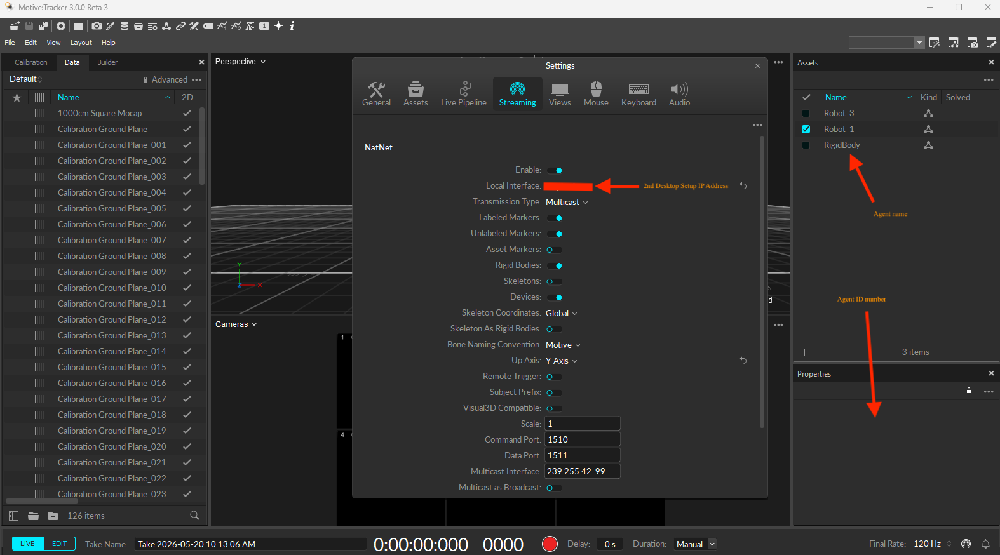

# Setup Guide 

-----------------------------------------------------------------------------------------------------

#### Motive Opitrack Setting

-----------------------------------------------------------------------------------------------------

#### File Modification

1. `src/crazyflie_missions/config/grid.yaml`: Flight altitude, agent names, agent ID numbers, ROS topic
   
2. `src/crazyflie_missions/crazyflie_missions/waypoint_tests/crazyflie_bridge_multi.py`: Agent names, radio URIs,
flight altitude (line 76)

3. `src/crazyflie_missions/crazyflie_missions/waypoint_tests/waypoint_manager_multi.py`: Agent names
> <b>Note</b>: You do not have to change the mode (waypoint vs. agriswarm algorithm), because it will automatically          determine upon running `src/crazyflie_missions/crazyflie_missions/agriswarm/agriswarm_node.py`. 

4. `src/crazyflie_missions/crazyflie_missions/agriswarm/agriswarm_node.py`: Agent names, ROS topic, grid size (line 66), agent starting position (line 72)

5. `src/crazyflie_missions/crazyflie_missions/agriswarm/main.py`: Grid size (line 12, 58, 68), number of agents (line 36), agent starting position (line 38)

